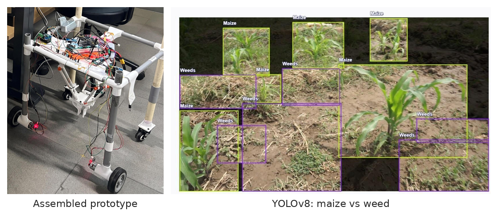
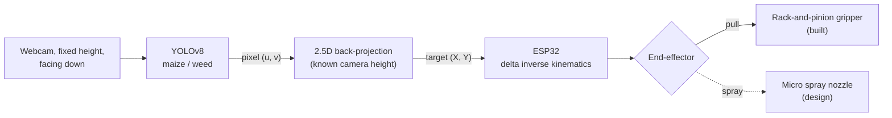
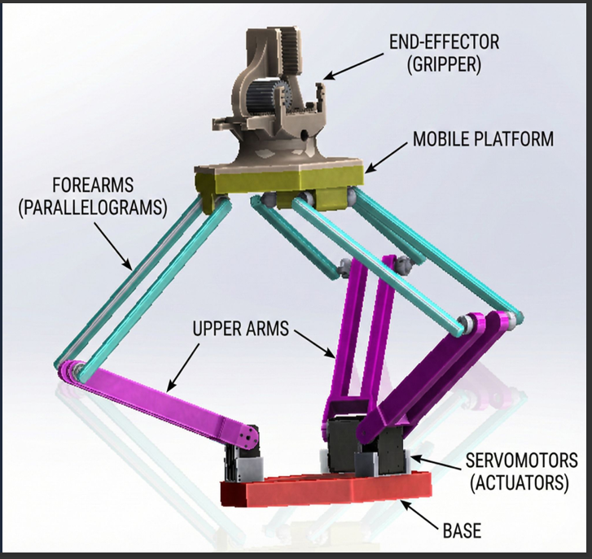
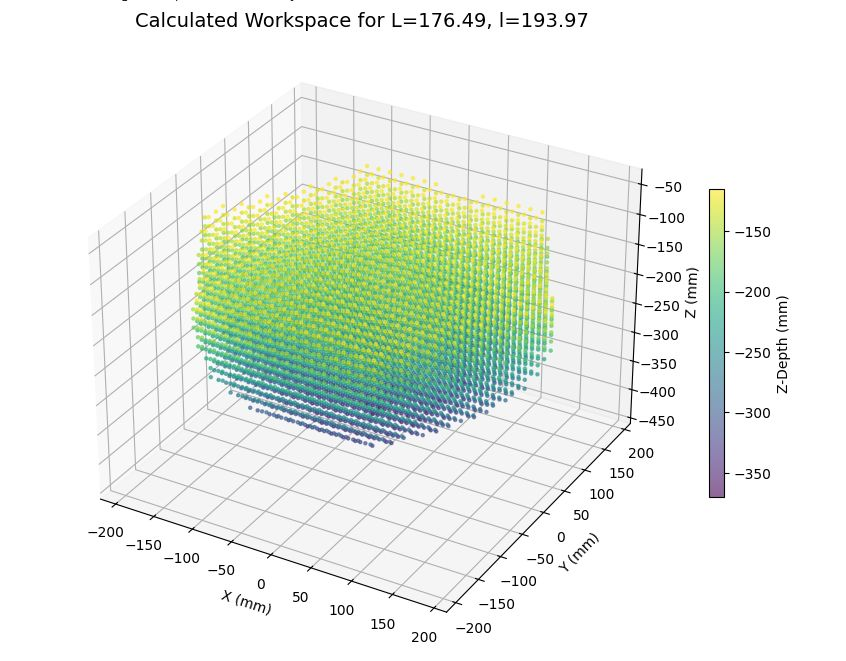
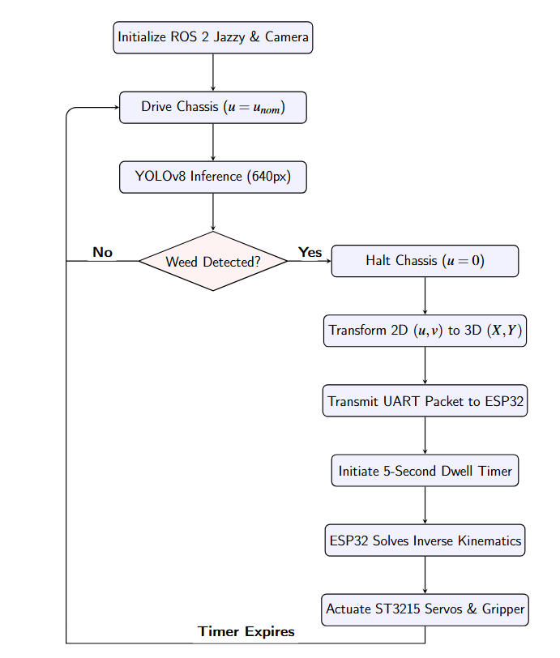

# Dual-Mode Weeder AMR: Project Overview

An Autonomous Mobile Robot (AMR) for precision weed removal. A camera detects weeds, and a fast delta manipulator then removes each one **either mechanically, by pulling it with a gripper, or chemically, with a targeted micro-spray**. This means herbicide is used only where pulling isn't suitable.

This was my final-year B.Tech project (21ARE495 Project Phase, Automation and Robotics Engineering, Amrita Vishwa Vidyapeetham), guided by Dr. Pramod Sreedharan. This repository is the public overview: system design, figures and presentations. The implementation code is kept in a separate private repository.

---

## Why dual-mode

Mechanical weeding alone can damage nearby crops. Blanket spraying wastes herbicide and harms the environment. Combining both on one end-effector lets the robot pick the method per weed, which improves precision and reduces chemical use.

## Final prototype

The finished robot (May 2026) demonstrates the **pulling mode**. A Raspberry Pi 4 running ROS 2 Jazzy does the detection and runs the state machine. An ESP32 solves the delta inverse kinematics and drives the servos. The delta arm is 3D-printed in PETG, uses Feetech ST3215 smart servos, and ends in a rack-and-pinion gripper. The spray head is part of the end-effector design.

## System pipeline

### Perception

- The final build uses **one webcam mounted facing straight down at a fixed height**. Because the camera height is known, each detection's pixel centre $(u, v)$ can be back-projected to ground coordinates $(X, Y)$ without stereo vision. The report calls this 2.5D mapping.
- A single-stage **YOLOv8** model separates *maize* from *weed* at 640 × 640 input.
- In the Phase I design, a YOLOv8n model was trained at 640 px for 75 epochs (batch 16), with OpenCV pre-processing and stereo depth planned for localisation. The final build replaced stereo depth with the fixed-height camera.

### Manipulation

- **3-DoF delta robot**, modelled in SolidWorks. Servo motors on a fixed base drive three identical arms. Each arm has a rigid upper link and a parallelogram lower link with ball-socket joints, so the moving platform keeps a constant orientation while it translates quickly and stiffly.
- **Dual-mode end-effector:** a servo-driven rack-and-pinion gripper for pulling weeds, with a micro spray nozzle in the design for targeted herbicide.
- On the prototype, the ESP32 computes the inverse kinematics analytically. ROS 2 with MoveIt 2 and Model Predictive Control (MPC) were part of the Phase I plan.

**Kinematics and reach (Phase I design study).** The design used an upper (active) arm of $L$ = 176.49 mm and a forearm (passive parallelogram) of $l$ = 193.97 mm. Inverse kinematics finds each motor angle with a tangent half-angle substitution. Forward kinematics intersects three spheres centred on the elbows (shifted inward by the platform radius). With these lengths, the maximum vertical reach is $L + l \approx$ 370 mm, and the working radius is about 135 mm at the nominal operating depth of roughly 240 mm. The built prototype uses different arm lengths.

| Dimensioned side view | Computed workspace |
|---|---|
|  |  |

### Control stack

The work is split between two processors. The Raspberry Pi 4 runs perception and ROS 2. The ESP32 drives the actuators. The two exchange JSON messages over a serial link.

The robot drives forward until a weed is detected, then stops, localises it, and sends the target to the ESP32. The ESP32 picks the weed, and after a short dwell the robot drives on:

---

## Presentations

| File | Contents |
|---|---|
| [`WEED REMOVAL AMR.pdf`](Presentations/WEED%20REMOVAL%20AMR.pdf) | Project Phase I review (20 slides): objectives, CAD, joint configuration, end-effector, vision pipeline, YOLOv8 training, 2D-to-3D localisation, delta kinematics |
| [`Research Methodology - Dual-Mode Weeder AMR.pptx`](Presentations/Research%20Methodology%20-%20Dual-Mode%20Weeder%20AMR.pptx) | Literature and methodology overview (7 slides): weed detection, SLAM-based navigation, manipulation approaches |

## Research scope

Precision-agriculture robotics, mobile manipulation in semi-structured fields, vision-driven target localisation, and hybrid (mechanical and chemical) actuation for selective intervention.

## Team

Adithya Pothula · Siddanth Bhogoju · Revu Danusith Kumar
Guide: Dr. Pramod Sreedharan · External guide: Prof. Prasanth Kumar R.
