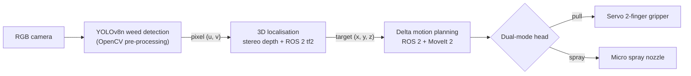
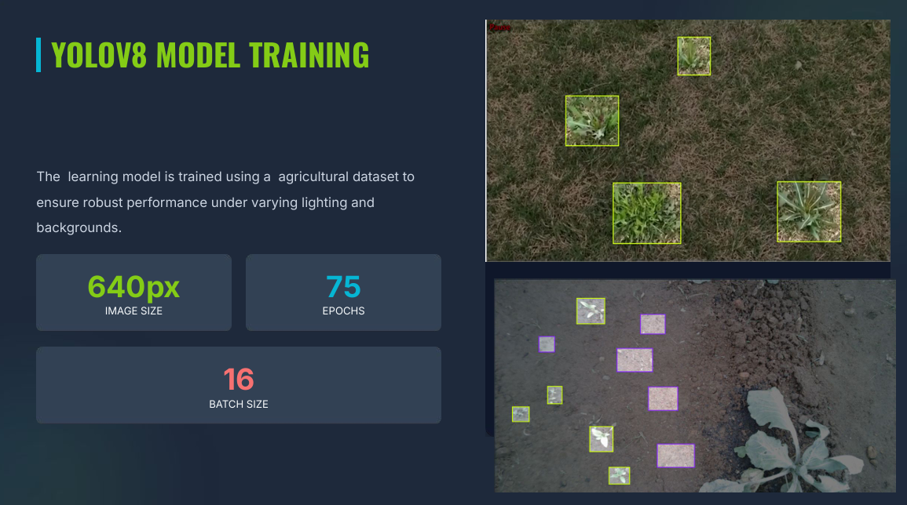
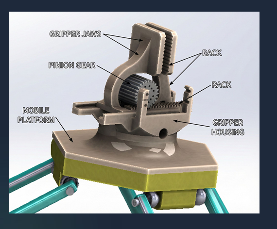
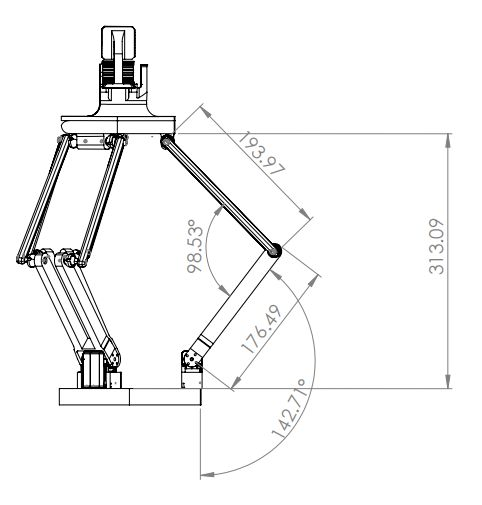
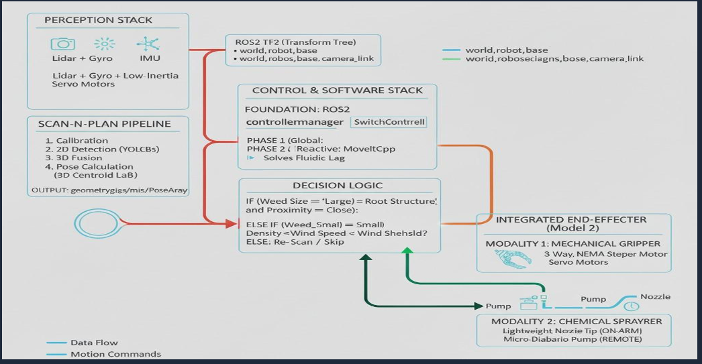

# Dual-Mode Weeder AMR: Project Overview

An Autonomous Mobile Robot (AMR) for precision weed removal. A camera detects weeds, and a fast delta manipulator then removes each one **either mechanically, by pulling it with a gripper, or chemically, with a targeted micro-spray**. This means herbicide is used only where pulling isn't suitable.

This was my final-year B.Tech project (21ARE495 Project Phase, Automation and Robotics Engineering, Amrita Vishwa Vidyapeetham), guided by Dr. Pramod Sreedharan. This repository is the public overview: system design, figures and presentations. The implementation code is kept in a separate private repository.

---

## Why dual-mode

Mechanical weeding alone can damage nearby crops. Blanket spraying wastes herbicide and harms the environment. Combining both on one end-effector lets the robot pick the method per weed, which improves precision and reduces chemical use.

## System pipeline

### Perception

- An RGB camera feed is resized and normalised with OpenCV, then passed to a **YOLOv8n** detector. The detector returns bounding boxes, confidence scores and weed class labels.
- The model was trained on an agricultural dataset at 640 px for 75 epochs with batch size 16.
- Each detection's pixel centre $(u, v)$ is combined with stereo depth $z$ and transformed into the robot frame with ROS 2 `tf2`. This gives the manipulator's target point.

### Manipulation

- **3-DoF delta robot**, modelled in SolidWorks. Servo motors on a fixed base drive three identical arms. Each arm has a rigid upper link and a parallelogram lower link with ball-socket joints, so the moving platform keeps a constant orientation while it translates quickly and stiffly.
- **Dual-mode end-effector** with a servo-driven two-finger gripper for pulling weeds and a micro spray nozzle for targeted herbicide.
- Motion planning uses ROS 2 and MoveIt 2. Model Predictive Control (MPC) was one of the project's planned control objectives.

**Kinematics and reach.** The upper (active) arm is $L$ = 176.49 mm and the forearm (passive parallelogram) is $l$ = 193.97 mm. Inverse kinematics finds each motor angle with a tangent half-angle substitution. Forward kinematics intersects three spheres centred on the elbows (shifted inward by the platform radius). With these lengths, the maximum vertical reach is $L + l \approx$ 370 mm, and the working radius is about 135 mm at the nominal operating depth of roughly 240 mm.

| Dimensioned side view | Computed workspace |
|---|---|
|  |  |

### Control stack

The prototype splits the work between two processors. A Raspberry Pi 4 runs perception and ROS 2. An ESP32 drives the actuators. The two exchange JSON messages over a serial link.

---

## Presentations

| File | Contents |
|---|---|
| [`WEED REMOVAL AMR.pdf`](Presentations/WEED%20REMOVAL%20AMR.pdf) | Project Phase I review (20 slides): objectives, CAD, joint configuration, end-effector, vision pipeline, YOLOv8 training, 2D-to-3D localisation, delta kinematics |
| [`Research Methodology - Dual-Mode Weeder AMR.pptx`](Presentations/Research%20Methodology%20-%20Dual-Mode%20Weeder%20AMR.pptx) | Literature and methodology overview (7 slides): weed detection, SLAM-based navigation, manipulation approaches |

## Research scope

Precision-agriculture robotics, mobile manipulation in semi-structured fields, vision-driven target localisation, and hybrid (mechanical and chemical) actuation for selective intervention.

## Team

Adithya Pothula · Siddanth Bhogoju · Revu Danusith Kumar
Guide: Dr. Pramod Sreedharan, Amrita Vishwa Vidyapeetham
